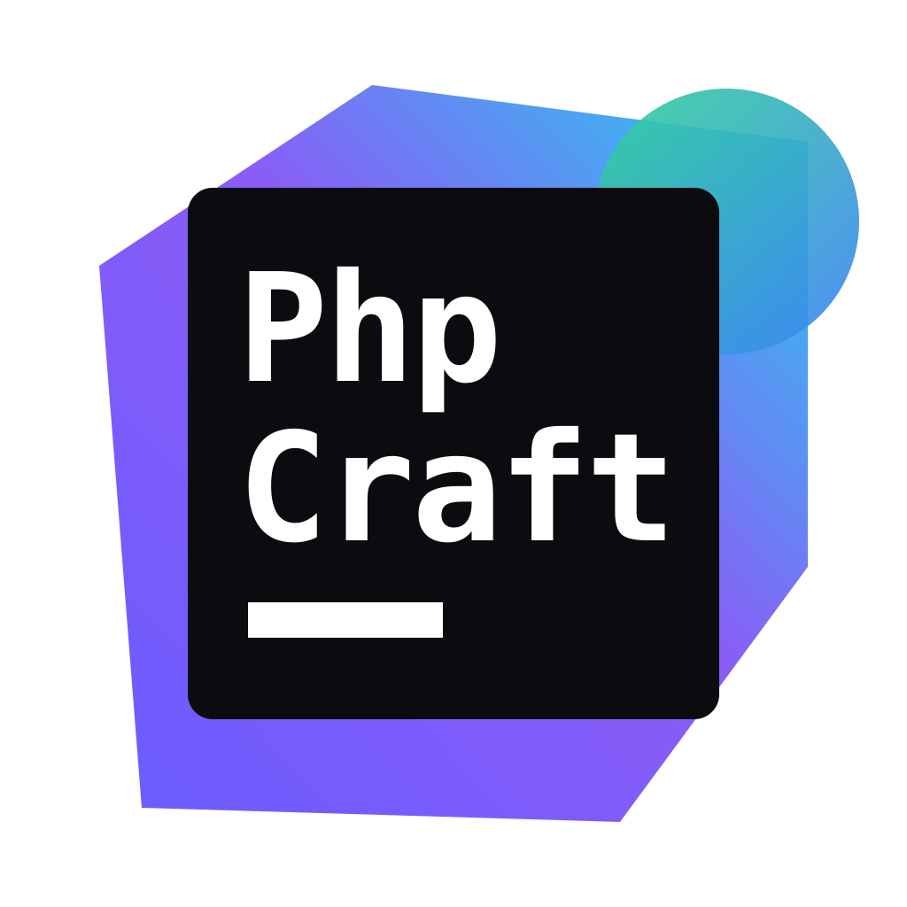

<p align="center">
  
</p>

<h1 align="center">PhpCraft</h1>

<p align="center">
  <b>PhpStorm in pure Rust — an open-source PHP &amp; Laravel IDE.</b>
</p>

<p align="center">
  A fast, native IDE for PHP and Laravel with a familiar workflow: go to declaration,
  completion with auto-import, Laravel-aware navigation, code generators, Artisan,
  Git and AI agents. Built on <a href="https://www.gpui.rs/">GPUI</a> and tree-sitter, no JVM.
</p>

<p align="center">
  
  
  
</p>

> [!NOTE]
> PhpCraft is an independent open-source project. It is **not affiliated with, endorsed by,
> or sponsored by JetBrains s.r.o.** (PhpStorm) or the authors of Laravel Idea. Product names
> are used only to describe what PhpCraft is compatible with or inspired by. No proprietary
> code is used. If you are a rights holder and have a concern, please write to
> **rasulchopurov@gmail.com** and we will address it promptly, including removing content.

## What works today

**Editor**
- Native GPU-rendered editor (GPUI): tabs, project tree, Darcula-like theme, PHP syntax highlighting
- Undo/redo with grouped edits, smart Home, auto-indent, clipboard, IME input

**PHP intelligence**
- Project-wide index of classes, members and functions, including `vendor/` (~9k classes in under a second, release build)
- **⌘B / ⌘+click** go to declaration: classes, methods, properties, constants, enum cases, functions, variables
- Type inference through `$this`, parameters, assignments, `new`, call chains, phpdoc `@return`/`@var`/`@property`/`@method`/`@mixin`
- Completion (`->`, `::`, `$`, classes, functions, keywords) with **automatic `use` import**
- **⌥⏎** "Import class" quick-fix, unresolved class highlighting, **⌃⌥O** Optimize Imports
- **⌘[** navigate back

**Laravel**
- ⌘+click and completion for `route()`, `view()`, `config()`, `__()`/`trans()`, `env()`, `Inertia::render()`
- Blade: `@include`/`@extends`/`@component`, `<x-component>`, `<livewire:component>`
- Eloquent forwarding (`User::where()->first()`), facades resolved to the real class (`Route::get` → `Router::get`)
- `[Controller::class, 'method']` callables
- **Laravel menu**: Code Generation, New Eloquent Model, New Pivot Table, Route Search, Run Artisan Command

**Code generation** (⌘N / ⇧⌘,)
- *New Eloquent Model*: fields table (type, nullable, unique, index, default), relations of every kind, id / UUID / ULID, timestamps, soft deletes, `$fillable`, custom table name
- Post-generations with editable names: migration, factory, seeder, JSON resource, Filament resource, REST-API controller, form requests, policy, observer; pivot migrations for `belongsToMany`
- Controller, Request, Resource, Policy, Observer, Factory, Seeder, Event, Listener, Job, Middleware, Command, Enum, Test (PHPUnit or Pest)
- **Filament 3, 4 and 5**: resources (with pages, schemas, tables), pages, widgets
- **laravel-modules**: pick a module or the app; files go to `Modules/<Name>/…`

**Framework completion**
- Validation rules in `rules()`, `validate()` and `Validator::make()` — per `|` segment
- Middleware aliases (from `bootstrap/app.php` / `Kernel.php`), Gate abilities and policy methods
- Filament: model columns and relations in `TextInput::make('…')`, `TextColumn::make('…')`, `->relationship('…')`
- Blade directives after `@`, model columns in `where('…')`/`orderBy('…')`, Inertia pages

**Editor & workspace**
- Find/replace (⌘F/⌘R), Find/Replace in Files (⇧⌘F/⇧⌘R), Search Everywhere (⇧⇧), Go to File/Class/Symbol
- ⌘/ comments, ⌘D duplicate, move/delete lines, multi-language highlighting (PHP, Blade, HTML, JS/TS, CSS, JSON, YAML, SQL, Markdown, logs…)
- Markdown preview: editor, split or preview (⌥⌘M)
- Project switcher in the title bar: Open…, Clone Repository…, recent projects, each in its own window
- Local History (⌥⇧H): the last 10 versions of every file, with diff and revert
- Auto save, JSON themes (⌘K ⌘T), editable keymap (⌘K ⌘S), settings (⌘,)
- macOS, Windows and Linux

**Git**
- Commit tool window (⌘0): Changes and Unversioned Files groups, multi-line message, Rollback, Amend, Commit / Commit and Push
- Diffs open as editor tabs ("Commit: File.php") with ↑↓ change and ←→ file navigation
- Change markers in the gutter, Annotate with Git Blame (⌥⌘A)
- Branch popup in the title bar: search, Update Project, Commit, Push, New Branch, Checkout Tag or Revision, Recent / Local / Remote trees grouped by folder, per-branch checkout, merge, rename, delete
- Git tool window (⌘9): branch tree, log with commit graph and filters (text/hash, branch, user, path), commit details, Console

**Settings Sync**
- Settings, keymap and themes synced through a secret GitHub Gist using the GitHub CLI (`gh auth login`)

**Artisan**
- ⌃⇧X: searchable command list; each command opens a small form for its arguments and options; output panel

## Quick start

```bash
git clone https://github.com/rasul-chopurov/phpcraft
cd phpcraft
cargo run --release -p phpcraft -- /path/to/your/laravel-app
```

Requires a recent stable Rust toolchain. On macOS, shaders are compiled at runtime, so the Xcode Metal
toolchain is not required. PHP must be on `PATH` for Artisan features.

## Keyboard shortcuts

| Action | Shortcut |
|---|---|
| Go to declaration | ⌘B, ⌘+click |
| Back | ⌘[ |
| Completion | ⌃Space |
| Quick-fix / intentions | ⌥⏎ |
| Optimize imports | ⌃⌥O |
| Laravel code generation | ⌘N, ⇧⌘, |
| Route search | ⌃⇧R |
| Run Artisan command | ⌃⇧X |
| Save / close tab / next tab | ⌘S / ⌘W / ⌃Tab |

## Architecture

```
crates/
  app/           GPUI application: workspace, editor view, dialogs
  editor/        rope buffer, selections, grouped undo
  project/       project tree
  php-syntax/    tree-sitter-php parsing and highlighting
  php-index/     symbol index, name resolution, phpdoc
  php-analysis/  type inference, go to declaration, completion, imports
  laravel/       Laravel navigation, generators, Artisan, routes
```

Framework support plugs into `php-analysis` through the `StringProvider` trait, the same way
future extensions will.

## Roadmap

- Highlighting for Blade, HTML, JS/TS, CSS, JSON, YAML, `.env`
- Find / Replace (⌘F, ⌘R), Find in Files (⇧⌘F), Search Everywhere (⇧⇧), Go to File/Class/Symbol
- Generate Helper Code, model from database table, Find Unused Views, Laravel settings
- Agent chat: Claude, Codex and opencode via the Agent Client Protocol, or with your own API key
- Terminal, run configurations, PHPUnit/Pest, Xdebug
- WASM extension API

## Contact

Questions, issues or rights concerns: **rasulchopurov@gmail.com**

## License

Apache-2.0. PhpStorm is a trademark of JetBrains s.r.o.; Laravel is a trademark of Taylor Otwell;
Filament and other names belong to their respective owners.
