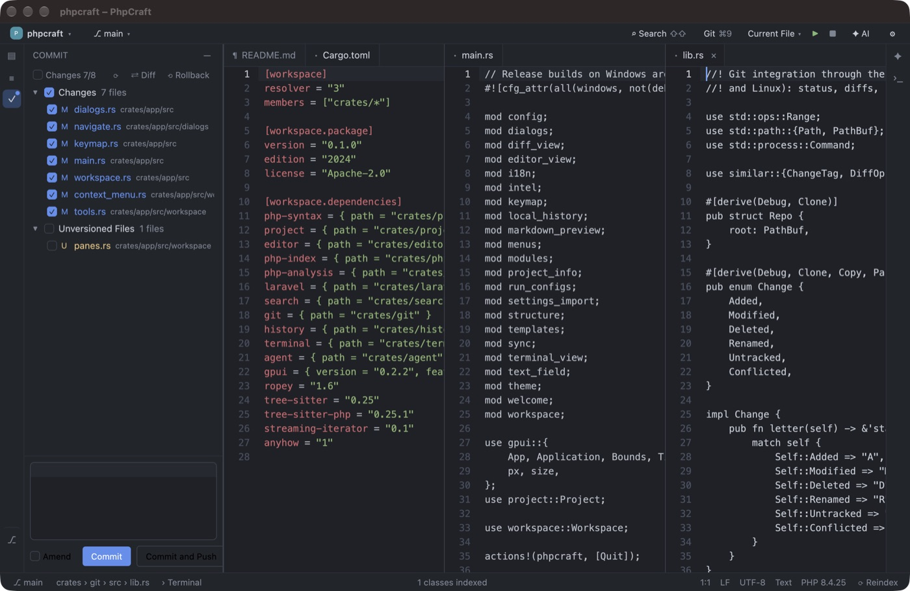

<p align="center">
  
</p>

<h1 align="center">PhpCraft</h1>

<p align="center">
  <b>A fast, open-source PHP &amp; Laravel IDE, rebuilt in pure Rust.</b><br>
  Native, offline, no JVM. Made with ❤️ in Azerbaijan · <a href="https://path.az/">path.az</a>
</p>

<p align="center">
  <a href="https://github.com/rasul-chopurov/phpcraft/releases"></a>
  
  
</p>

<p align="center"></p>

## Features

- **PHP**: project index with `vendor/`, go to declaration, type inference, completion with auto-import, Optimize Imports
- **Laravel**: `route()`, `view()`, `config()`, Blade, Eloquent, facades, validation rules, Livewire, Filament, Inertia; 44 code generators (⇧⌘,)
- **Git**: Commit window, side-by-side diff, log with graph, branches, blame
- **Database**: MySQL, MariaDB, PostgreSQL, SQLite; tables open as editable tabs
- **Workspace**: project tabs, split editors, Search Everywhere, terminal, run configurations, Artisan
- **AI**: Claude, Codex, OpenCode and Gemini via ACP or API key

## Install

[Download from Releases](https://github.com/rasul-chopurov/phpcraft/releases) (alpha):

| Platform | Files |
|---|---|
| macOS | `.dmg` for Apple silicon (arm64) and Intel (x64) |
| Windows | `Setup.exe` for x64 and x86, portable `.zip` |
| Linux | `.deb` (Ubuntu/Debian) and `.tar.gz` (any distro), x86_64 and arm64 |

Or build from source:

```bash
cargo run --release -p phpcraft -- /path/to/laravel-app
```

PHP on `PATH` enables Artisan and database features.

## Disclaimer

PhpCraft is an independent project, **not affiliated with JetBrains s.r.o.** (PhpStorm) or the
authors of Laravel Idea. No proprietary code is used. Concerns: **rasulchopurov@gmail.com**.

## License

Apache-2.0 · Part of [path.az](https://path.az/), open source products from Azerbaijan ❤️
