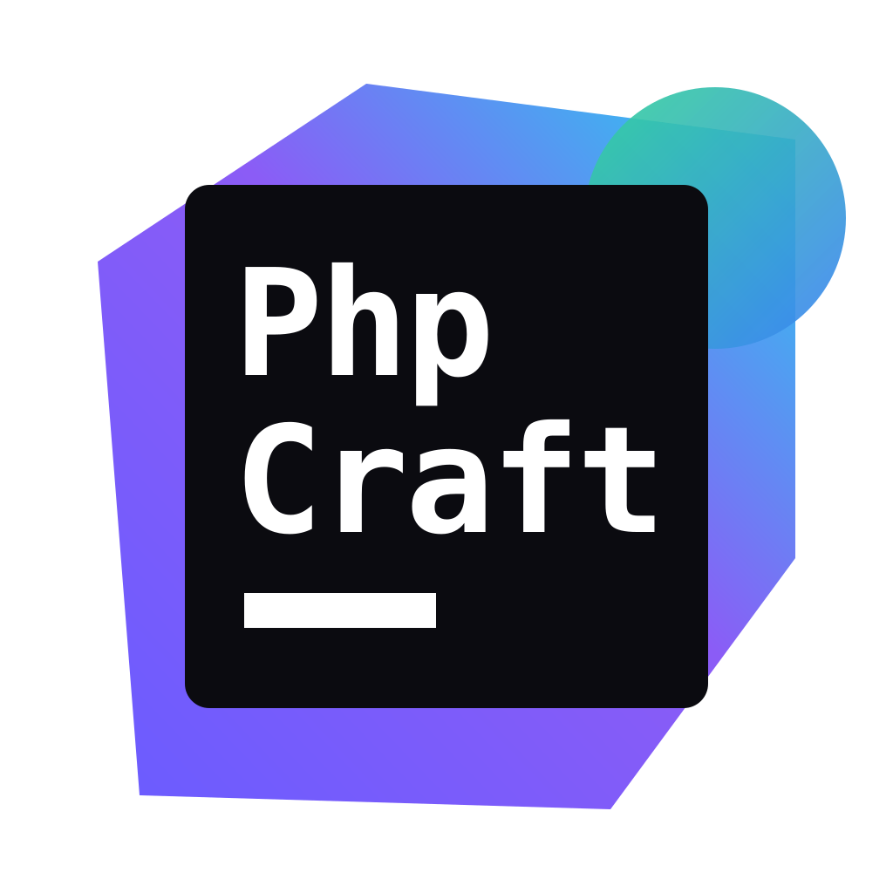
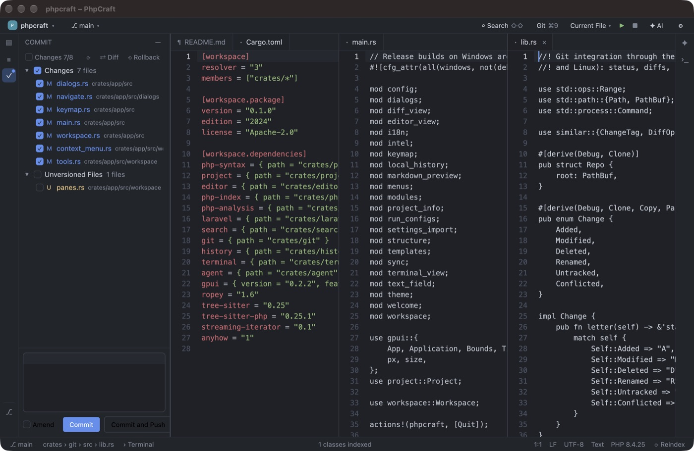

<p align="center">
  
</p>

<h1 align="center">PhpCraft</h1>

<p align="center">
  <b>A fast, open-source PHP &amp; Laravel IDE, rebuilt in pure Rust.</b><br>
  Native, offline, no JVM. Made with ❤️ in Azerbaijan · <a href="https://path.az/">path.az</a>
</p>

<p align="center">
  <a href="https://github.com/rasul-chopurov/phpcraft/releases"></a>
  
  
</p>

<p align="center"></p>

## Features

- **PHP**: project index with `vendor/`, go to declaration, type inference, completion with auto-import,
  Import Class (Code ▸ Import Class…, editor context menu), Optimize Imports, copy/paste carries `use`
  statements into the target file, Move Class (F6) to another namespace with its references
- **JS/TS & Vue**: go to declaration, find usages, rename and completion across ES modules, JSX/TSX, `require`, the `<script>` blocks of Vue/Svelte components, aliases from `tsconfig.json` `paths` / `baseUrl` and Vite's `resolve.alias`, and import rewriting when a file is renamed
- **Laravel**: `route()`, `view()`, `config()`, Blade, Eloquent, facades, validation rules, Livewire, Filament, Inertia; 44 code generators (⇧⌘,) that also target laravel-modules; the Modules window lists them, enables/disables them and creates new ones (`module:make` with the package's default, plain, api or web layout) or deletes them
- **Git**: Commit window, side-by-side diff, three-way merge window for conflicts (common ancestor, line-level auto-merge), log with graph, branches, blame
- **Database**: MySQL, MariaDB, PostgreSQL, SQLite; tables open as editable tabs
- **Workspace**: project tabs, split editors, Search Everywhere, terminal, run configurations, Run Anything (⌃⌃: configurations, Artisan commands, any shell line, with a history), structural search (⌥⌘F: `$A$` holes, project-wide replace), Artisan,
  session restore (tabs, panes, carets, scroll position, folded regions), reload of files changed on disk (watched by the OS, a changed buffer and a deleted file both ask first), font zoom (⌘+ / ⌘− / ⌘+scroll),
  saved window layouts (View ▸ Window Layouts…), Russian UI (menu bar, tool windows,
  Search Everywhere, editor context menu)
- **Deployment**: SFTP servers with a per-server picker (⌥⇧⌘U / ⇧⌥⌘D), automatic upload on
  save, drag and drop in both directions (project tree ↔ server browser), folder download,
  rename and delete on the server, an upload chip in the tab bar that shows whether the open
  file is up to date, and `.git`/`vendor`/`node_modules` left out of uploads
- **Debugging**: Xdebug with path mappings (`.phpcraft/debug.json`), breakpoints with PHP
  conditions listed in the Debug window, watch expressions that are re-evaluated on every
  stop, step over / into / out, and an evaluate field for the current frame
- **AI**: Claude, Codex, OpenCode and Gemini via ACP or API key

## Install

[Download from Releases](https://github.com/rasul-chopurov/phpcraft/releases) (alpha):

| Platform | Files |
|---|---|
| macOS | `.dmg` for Apple silicon (arm64) and Intel (x64) |
| Windows | `Setup.exe` for x64 and x86, portable `.zip` |
| Linux | `.deb` (Ubuntu/Debian) and `.tar.gz` (any distro), x86_64 and arm64 |

Or build from source:

```bash
cargo run --release -p phpcraft -- /path/to/laravel-app
```

PHP on `PATH` enables Artisan and database features.

## Disclaimer

PhpCraft is an independent open-source project. No proprietary code is used.
Concerns: **rasulchopurov@gmail.com**.

## License

Apache-2.0 · Part of [path.az](https://path.az/), open source products from Azerbaijan ❤️
